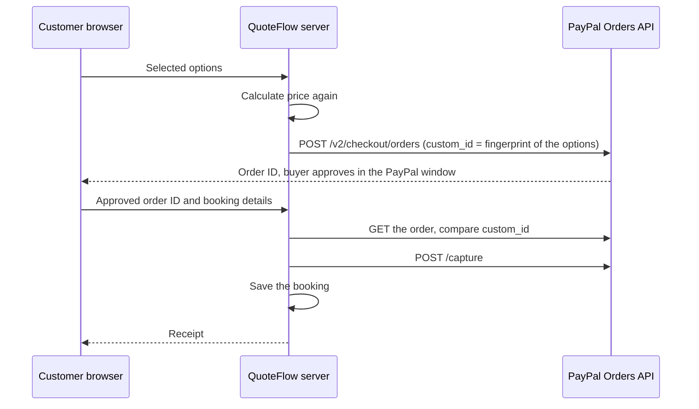

# QuoteFlow + PayPal

Instant quotes, AI-assisted estimates, and PayPal deposits for local service businesses (cleaning, landscaping, wedding photography).

Built for the PayPal AI Hackathon 2026.

**Live demo:** <https://quoteflow-2vql.onrender.com> (PayPal sandbox, no real money). The free server sleeps when idle, so the first page can take up to a minute to load.


## Problem

A small service business loses time on every job before any work starts. A customer asks for a price, the owner replies by hand, and the customer can still cancel at no cost. When a customer does not show up, the owner has no deposit to cover the lost slot. After the job, the owner must chase the balance.

QuoteFlow gives each business one booking link. The customer describes the job in their own words, sees a price, and pays a deposit through PayPal. The owner sees the booking, requests the balance after the job, and refunds a cancelled booking with one button.

## Features

**For the customer**

- AI quote assistant: Claude reads a plain sentence such as "3 bedroom house, need it tomorrow" and fills in the quote. The customer can check and change every option.
- Booking agent: the customer can book the whole visit by chat. The agent asks for what is missing, prices the job, and opens a PayPal order for the customer to approve.
- Itemized quote, arrival time selection, and an e-signature.
- PayPal deposit of 25% of the total (minimum $10), with a receipt that shows the PayPal order number.
- A balance page at `/pay/<booking id>` that reads like an invoice.

**For the owner**

- A dashboard with upcoming visits, deposits received, balances due, and the booking link.
- New bookings appear without a page reload (server-sent events).
- Request the balance after the job. Cancel a booking and refund the deposit through PayPal.
- Edit the base price, unit price, and add-ons, with a live preview of the customer page.

| Customer booking page | Owner dashboard |
|---|---|
|  |  |

## How the PayPal integration works

The browser never decides the amount. The server calculates the price again from the business's saved settings, and it checks each PayPal order before it saves a booking.



| Step | PayPal API |
|---|---|
| Deposit and balance orders | `POST /v2/checkout/orders` |
| Order check | `GET /v2/checkout/orders/{id}` |
| Payment capture | `POST /v2/checkout/orders/{id}/capture` |
| Refund on cancellation | `POST /v2/payments/captures/{id}/refund` |

The server rejects a changed price, an order for different options, and an order the buyer did not approve. When PayPal keys are set, it also rejects demo payments. Client secrets stay on the server.

### The booking agent

Claude runs a tool loop on the server (`server/agent.mjs`) with two tools. The agent has a limited role in the payment:

| The agent can | The agent cannot |
|---|---|
| Get a price from the server (`quote_job`) | Set or change a price |
| Open a PayPal deposit order (`prepare_booking`) | Approve or capture a payment |

The customer sees a card with the amount, the date, and their details, and approves the order in PayPal. Then the standard booking route checks and captures the order. A message such as "make it $1" cannot change the amount, because the server calculates the price from the owner's settings.

## Tech stack

React, TypeScript, Vite, and Tailwind in the browser. Express on Node.js 24 on the server, on Render. Supabase for the database and owner sign-in. PayPal Orders and Payments APIs. Claude Haiku 5.5 with structured output for the AI quote assistant, with per-IP and daily limits on calls.

## Run locally

Requires Node.js 24 or newer (the server runs the shared TypeScript pricing code directly).

```sh
npm install
cp .env.example .env    # optional: fill in keys (see below)
npm run server          # API on http://localhost:8787
npm run dev             # app on http://localhost:5173 (proxies /api to the server)
```

Every key is optional. Without one, that part runs in a local fallback:

| Variable | Without it |
|---|---|
| `PAYPAL_CLIENT_ID`, `PAYPAL_CLIENT_SECRET` | Demo payment buttons instead of PayPal |
| `ANTHROPIC_API_KEY` | The AI quote box says it is offline |
| `SUPABASE_URL`, `SUPABASE_SECRET_KEY` | Bookings live in server memory and reset on restart |
| `SUPABASE_PUBLISHABLE_KEY` | The dashboard opens without sign-in |
| `DEMO_OWNER_PASSWORD` | No "Use the demo account" button |

To keep data in Supabase, create a project and run [`supabase/schema.sql`](supabase/schema.sql) once in its SQL Editor (run it again after pulling schema changes; it is safe to repeat).

With sign-in on, `/dashboard` asks owners to sign in or create an account. A new account gets its own booking page at `/b/<business-name>`.

Pages: `/` overview, `/b/sparkle-co` customer booking page, `/dashboard` owner dashboard, `/pay/<booking id>` balance payment.

## Testing with the PayPal sandbox

Sandbox payments use test money. You need a PayPal sandbox **Personal** account to pay.

**Sandbox buyer account:** SANDBOX_BUYER_DETAILS

1. Open <https://quoteflow-2vql.onrender.com/b/sparkle-co>.
2. Type a job description into the AI box, or set the options by hand.
3. Choose a date and an arrival time, then enter a name, an email address, and a signature.
4. Accept the terms and pay the deposit with the sandbox buyer account.
5. Open <https://quoteflow-2vql.onrender.com/dashboard> and select **Use the demo account**. The booking is in the bookings list.
6. Select **Request balance**, open the link, and pay the balance. The booking changes to paid in full.
7. On a different booking, select **Cancel and refund**. The server refunds the deposit through PayPal.

To test the booking agent, select **Or book the whole visit by chat** on the booking page. Describe the job, give a date, an arrival window, a name, and an email, then approve the deposit on the card.

Run the server tests with `npm test`.

To run this with your own keys, create a sandbox app in the [PayPal Developer Dashboard](https://developer.paypal.com/) under Apps & Credentials, and put its keys in `.env`.

## What changed since October 1, 2026

The first version of QuoteFlow was built on October 13-18, 2026, with no payments and no server. The commit history starts from that export. This repository added:

- All PayPal payments: deposit, balance, and refund, through the server.
- The AI quote assistant and the booking agent.
- A server, a database, and owner accounts, so each business has its own booking page.
- New customer booking, owner dashboard, balance, and landing pages.

## License

[MIT](LICENSE)
